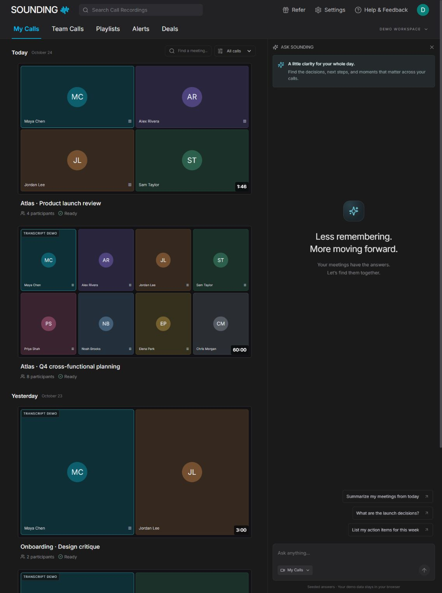
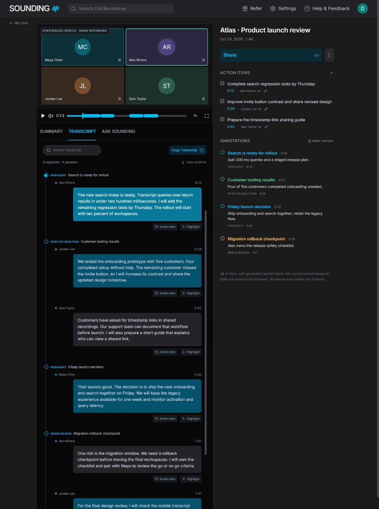

# Sounding

**Your meetings, remembered.** An independent Fathom-inspired educational recreation built for the 8x Product Engineer assessment. Not affiliated with or endorsed by Fathom.

Explore a working meeting library, synchronized speech and transcript, structured summaries, time-linked actions and highlights, genuine search, and read-only sharing. All people and meeting content are fictional.

**Live HTTPS demo:** awaiting deployment approval. No public deployment has been claimed or verified yet.




## Run locally

Requires Node.js **22.13+** (tested with 24.16.0) and npm.

```sh
npm ci
npm run dev
```

Open [localhost:3000](http://localhost:3000). The `predev` script creates an ignored `.env.local` containing a random local `SHARE_SECRET` if that file does not already exist. It never replaces an existing environment file. If you already have `.env.local`, add a random secret of at least 32 characters yourself. No account, database, API key, or conferencing connection is needed.

```sh
npm run typecheck
npm run lint
npm test
npm run build
npm start
```

For a clean production-server check while development remains running:

```sh
npm run build
npm start -- --port 3001
npm run test:smoke -- http://localhost:3001
```

## What works

- **My Calls:** date groups, fictional participant thumbnails, recording/transcript filters, real title/person/content search, no-results states, responsive navigation.
- **Meeting detail:** the reference’s compact dark two-column layout, cyan accents, black content pane, Summary / Transcript / Ask tabs, action sidebar, annotation rail, and share dialog.
- **Audio:** a self-generated 1:46 spoken launch review, play/pause, mute, 0.75–2× speed, keyboard-accessible seek slider, fullscreen, and time-linked transcript/summary/annotation navigation. Speaker tiles are illustrative, not video footage.
- **Transcript:** measured variable-height virtualization, active speaker/segment, auto-scroll toggle, keyword/speaker search, copy, UTF-8 download, actions and highlights from individual segments.
- **Summaries:** Enhanced and Project Update, progress state, copy, regeneration, concise/full and decision/action-focused variants. Custom notes persist. English/Auto select the same English source; there is no translation service.
- **Action items:** seed items, manual create/edit, completion, assignee changes, timestamp links, persistence.
- **Annotations:** Highlight, Positive Reaction, Needs Review, Feedback, Bookmark, timeline markers, category colors, timestamp navigation, and workspace timestamp-link copy.
- **Ask Sounding:** deterministic content/keyword-based answers with citations. It does not call a model.
- **Sharing:** a copied, unlisted guest link contains an encrypted, authenticated snapshot of current actions/highlights/summary preferences. The read-only viewer needs no account. Invalid, tampered, expired, or restricted snapshots expose no meeting state.
- **Long meeting:** 8 speakers, 60-minute synthetic timeline, 240 searchable segments, eight workstreams, multiple decisions/actions/highlights. It has **no recording**, and playback is explicitly disabled. The timeline navigates its transcript.

## Demo meetings

| Meeting                                    | Content                                                                      | Media                                              |
| ------------------------------------------ | ---------------------------------------------------------------------------- | -------------------------------------------------- |
| Atlas · Product launch review              | 4 fictional speakers, 8 aligned segments, launch/onboarding/search decisions | Self-generated Microsoft Zira speech, 106.107710 s |
| Atlas · Q4 cross-functional planning       | 8 fictional speakers, 240 segments, 8 workstreams, 60-minute timeline        | Transcript only; no hour-long recording            |
| Onboarding · Design critique               | 2 speakers, 12 segments, contrast/mobile/search feedback                     | Transcript only                                    |
| Customer voice · Sharing that feels simple | 2 speakers, 12 segments, permission/timestamp-link discussion                | Transcript only                                    |

Open the launch review for playback. Search **rollback** for a short-call segment, **Priya Shah** for a speaker, or **amber lighthouse** for a late planning discussion. The planning deep link `/calls/quarterly-planning?t=3540` jumps to **59:00**.

## Architecture

Next.js App Router + React + strict TypeScript, Tailwind CSS, locally bundled Inter, Lucide, Zod, and TanStack Virtual. A modular monolith keeps the domain model, fixture data, summary rules, persistence, encryption, and UI separate.

```text
src/app/                 Routes, loading/error/not-found, share API
src/components/          Shell, library, media, transcript, summaries, dialogs
src/lib/domain.ts        Domain types, time lookup, genuine search
src/lib/data.ts           Referentially valid fictional fixtures
src/lib/persistence.ts    Browser state adapter and cross-tab refresh
src/lib/state.ts          Zod schemas and versioned restoration
src/lib/summary-service.ts Replaceable deterministic summary/answer boundary
src/lib/sharing.ts        Authenticated, expiring, encrypted snapshot links
public/media/             Locally generated spoken demo
```

No PostgreSQL or Prisma is required for this demo. Versioned **localStorage** persists each evaluator’s edits in their own browser; blocked storage falls back to session memory with a visible notice. Zod rejects malformed records, invalid assignees, and out-of-range timestamps. The persistence adapter can be replaced by an authenticated database implementation without changing the domain model.

**Sharing persistence:** AES-256-GCM + random 96-bit nonce encrypts and authenticates a compressed snapshot in the URL. A stable server `SHARE_SECRET` makes links work across serverless instances and cold starts without database provisioning. The server validates scope, payload size, expiry, timestamps, and speaker references. Share creation rejects foreign origins; invalid/restricted viewers fail closed. Shared routes are not indexed and use no-referrer/no-store headers. No credentials or external accounts are included in a snapshot.

## Deliberate boundaries

- This is an **open fictional demo workspace**, not an authenticated private workspace. Do not enter real meeting data or personal information.
- Guest links are **immutable 24-hour snapshots**. Later edits are not synced. Restricting new sharing disables guest-link creation; **already-created links remain valid until expiry**. Rotating the deployment secret invalidates every existing link. Immediate per-link revocation and invitations need a database/auth service and are not implemented.
- Speech is synthesized locally with the same installed TTS voice at varied rates. Four speaker labels come from the script; no speech recognition or diarization occurs. Short-call timestamps are derived from actual WAV PCM frame counts.
- Summary regeneration and Ask responses are deterministic. No LLM inference occurs, and free-form guidance is saved as a reference note rather than interpreted.
- No real calendar sync, meeting bot, conferencing capture, CRM, billing, alerts, team administration, email sending, or clip editor is connected. Secondary navigation explains its demo boundary. These features were deprioritized to finish the core meeting journey.
- Working playback/sync, positive content search, multi-speaker behavior, guest viewer, mobile views, and eight-speaker rendering were independently implemented where source reconnaissance could not verify them.
- The original screenshots remain local in ignored `recon/screenshots/`. Public documentation uses **only screenshots of this fictional implementation**.

## Verification

`npm test` verifies fixture integrity, PCM duration, timestamp lookup, actual search coverage, stored-state validation, summary variations, grounded citations, authenticated share decryption, expiry, tampering, wrong keys, and restricted snapshots. `test:smoke` exercises the production HTTP routes without cookies or account credentials.

Actual browser checks and corrections are recorded in [docs/VERIFICATION.md](docs/VERIFICATION.md). They cover playback, seek/speed/search, action creation/completion/refresh, highlight category/refresh, template/customization/refresh, guest read-only behavior, no-results states, long-transcript navigation, and responsive layouts. Performance evidence reports DOM row counts and tested interactions; no fabricated frame-rate benchmark is claimed.

## Deploy to Vercel

1. Import `UmairRathore/fathom-clone` into Vercel after approving repository publication/deployment.
2. Keep the detected Next.js framework and `npm run build` command. Use Node.js 24 (or 22.13+).
3. Add **`SHARE_SECRET`** as an environment variable for each environment. Generate it locally with `node -e "console.log(require('node:crypto').randomBytes(32).toString('hex'))"`. Keep it stable; never commit it.
4. Deploy. No database, upload bucket, or writable server filesystem is required.
5. Open `/home` in a fresh browser, play the launch review, create a new share link, and open it without account credentials. Localhost share URLs will not work on the deployed host; generate fresh links there.
6. Run `npm run test:smoke -- https://YOUR-DEPLOYMENT` for public endpoint checks. Without the local server’s matching secret, signing-specific negative tests are skipped; unit tests still cover them.
7. Replace the pending live-demo notice with the verified HTTPS URL.

The repository includes Vercel configuration and `.env.example`. `.env.local`, build output, dependencies, and private reconnaissance images are ignored. Share creation returns an actionable error if the deployment secret is missing.

## Assessment walkthrough

See [docs/DEMO.md](docs/DEMO.md) for a short demonstration script, tested paths, and honest simulation boundaries. Automatic `UserPromptSubmit` / `Stop` hooks and prior agent logs are preserved. The current response is only captured once its turn finishes, so a final log commit necessarily follows that event in a later turn.
