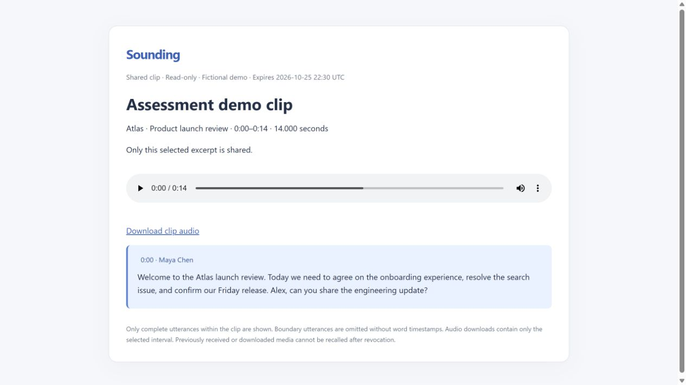

# Module 2 — clip gap audit

`a4912b9` is an ancestor of the current branch. Its editor, viewer, saved-range schema, Neon workspace JSON persistence, encrypted expiring demo snapshots and seeded PCM WAV extraction are already present and are being extended rather than rebuilt.

| Capability before this module | Status                             | Critical gap                                                                  |
| ----------------------------- | ---------------------------------- | ----------------------------------------------------------------------------- |
| Saved ranges                  | Working for demo / partial overall | Uploaded meeting controls disabled                                            |
| Guest tokens                  | Working for demo                   | No revocation                                                                 |
| External clip viewer          | Partial                            | Uploads unsupported; protected deployment requires Vercel access              |
| Audio extraction              | Partial                            | Server PCM WAV slicing only; real AAC/MP4 unsupported                         |
| Database persistence          | Working                            | Clips already live in owner/session-scoped Neon meeting state                 |
| Authentication checks         | Working                            | Reuse ownership and expired-session checks                                    |
| Range enforcement             | Partial                            | WAV bytes are scoped; boundary transcript utterances can expose outside words |
| Accessibility/tests           | Working foundation                 | Missing real-recording, revocation and library-management tests               |

The implementation uses a secure audio-only alternative for uploaded videos. Guests receive a standalone selected PCM WAV, not the source video, original storage capability or full owner media endpoint. No video transcoding, AI request, OAuth, bot or calendar work is included.

## Completed workflow

The existing editor, viewer, share endpoint and clip media endpoint are reused. Clips remain in `MeetingState.clips`, persisted by the existing Neon owner/session-scoped workspace mechanism. A new migration adds revocable grants, not a duplicate clip model.

1. Open a meeting and choose **Create clip**, a transcript segment's **Create clip**, or a highlight's **Clip** action.
2. Adjust start/end seconds, inspect the duration, and choose **Preview selected audio**. The owner preview is a server-extracted file with only those samples; changing boundaries invalidates the preview. Opening the editor pauses the main player.
3. Set a title and save. The editor waits for Neon persistence before reporting success. The meeting's Clips section lists title, source, duration, preview/adjust, sharing, revocation and deletion.
4. Choose **Copy link / share**. For private uploads, explicitly authorize public access to the selected excerpt. Inspect exactly which complete transcript utterances will be shared before creating the link.
5. Copy the link or use the selectable fallback field. The external recipient sees a minimal Sounding page with clip title, source meeting title, selected audio, duration and bounded transcript. No Sounding account is needed.
6. Revoke from the clip library. New page, status and media requests fail immediately. Editing/deleting a clip also atomically revokes grants, including preparations in flight; undoing an edit does not revive them.

## Media and security

- Uploaded MP4/AAC is decoded locally on the server with the packaged FFmpeg binary. A 16 kHz mono PCM WAV contains precisely the rounded selected sample interval. No source file is altered. At most 100 ms of an audio/container tail mismatch may be padded with silence; missing audio beyond that fails closed.
- Existing seeded WAV extraction is preserved. Unusually large demo excerpts are resampled to keep responses below serverless limits. Exports are audio, not video; this is the secure supported alternative for the assessment.
- Limits: 0.1–120 seconds per clip and 20 preparations per workspace per day. Re-copying a still-active unchanged clip reuses its grant and artifact. Share lifetime is 24 hours.
- Opaque HMAC bearer tokens disclose no database identifiers. Only a token hash is indexed in Neon. Creation requires an active owning session, persisted matching clip, explicit public access, valid bounds and a ready real recording. Cross-account and cross-origin changes fail closed.
- Private storage holds a separate derived artifact. The guest endpoint proxies only that artifact, implements artifact-local HTTP byte ranges and rechecks the grant after storage access. It never returns an unrestricted private recording URL or storage credential.
- Every guest request validates expiry, revocation, the saved range/title and recording availability. Pages and media use no-store/no-referrer headers; the standalone viewer also restricts scripts, connections and media to its own origin with CSP.
- Partial boundary utterances are omitted because the saved transcript has no word timestamps. Guests never receive the full text of an utterance extending outside the clip. Owners can choose complete source-segment boundaries to include its text.
- Original AI/manual/review highlights remain separate and unchanged. Clip creation only reads their range. The Module 1 source review and suggested moments remain available.
- Revocation cannot recall audio already downloaded or buffered. The viewer checks link status every five seconds and removes playback/transcript after a revoked status. New server requests are denied immediately.
- Existing historical v1 fictional demo snapshot links remain backward compatible until their original 24-hour expiry; those old stateless snapshots cannot be individually revoked. All newly created clip links use revocable v2 grants. Full uploaded-recording sharing remains disabled.
- Revocation attempts deletion of derived artifacts. `npx tsx scripts/cleanup-clip-shares.ts` removes inaccessible revoked/expired leftovers; its selection is restricted to `clips/`, never original recordings. Private transcript/media are not included in Git or deployment uploads.

## Deployment boundary

The existing application remains at the protected preview. Vercel Authentication prevents anonymous recipients from reaching any path there, so a separate **free clip-only viewer** is hosted at `sounding-clips-umair-rathore.vercel.app`. Its build uses the same `ClipViewer` and grant-validation code; it exposes only shared-clip/status/media handlers and static presentation assets. No login, owner API, recording list, internal notes or workspace routes are deployed there.

Build it with `node scripts/build-clip-viewer.mjs`; the generated project lives in ignored `.vercel/clip-viewer-project`. Its three server-only configuration values are `DATABASE_URL`, `SHARE_SECRET` and `BLOB_READ_WRITE_TOKEN`. The protected application uses the trusted `CLIP_SHARE_ORIGIN` to produce guest URLs. Never put values or bearer URLs in documentation or command arguments. The existing public `fathom-clone-three.vercel.app` deployment is not changed.

## Verification evidence

- Automated tests cover exact generated PCM samples at beginning/middle/end, fractional minimum duration, bounded HTTP ranges, full-utterance-only text, anonymous identities, existing grant reuse, owner spoofing, expiry, revocation, persistent clips, edits/deletion, stale grants and concurrent preparation cancellation. Existing authentication, demo, processing, transcript and summary tests remain required.
- The local real-media HTTP audit passed **57 checks**. Three selected ranges from the original authorized recording match independent full-source PCM decoding sample-for-sample. Each anonymous guest page/media opened without cookies; outside-artifact ranges were rejected; revocation immediately denied page and media. Original transcript and highlight state were unchanged. Temporary HTTP test clips were removed.
- Real browser: an existing highlight prefilled 251.284–255.534 seconds. Its extracted preview and anonymous external playback both reported 4.250 seconds, reached currentTime 4.250, and ended paused. Save, explicit share consent, copy confirmation, external opening, revocation, adjusted boundaries and deletion were exercised. The original highlight remained present.
- Fictional demo: transcript selection prefilled its precise 0–13.707210884353742 source range. A 14-second saved clip displays exactly one complete utterance in the public viewer. The privacy-safe screenshot below contains only fictional content and no bearer URL.
- Only the in-app browser is enabled in this environment. The recipient was tested in a separate tab on the distinct public origin, backed by independent cookie-free HTTP requests. A second browser engine or fresh browser profile was not available; no such test is claimed.
- The clipboard button reports successful copying and a selectable link fallback is provided. Independent OS clipboard readback is not claimed.
- Read-only capture verification found the first prompt/response pair intact and the latest completed automatic response (event 22) exactly matching the actual Codex session text. The new Module 2 prompt is complete event 23; framed records validate as UTF-8 with no incomplete frame. The checked historical prefix and older session logs remain unchanged. This module's final Stop event can only be verified after the turn ends.
- Additional OpenAI API expenditure: **$0**. No retranscription, meeting analysis or other model request is performed by this module.

