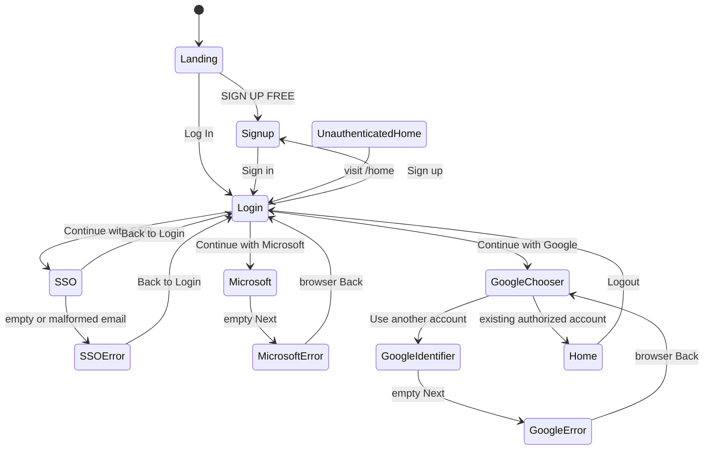

# Verified authentication journey
Routes: landing https://www.fathom.ai/; signup /users/sign_up; login /users/sign_in; SSO /users/sign_in/sso; home /home. Provider query strings never recorded.

Existing signed-in Google test account selection returned directly to Fathom /home without new credential/consent prompt. Logout tested twice. Explicit /home after logout redirected to /users/sign_in. This is unauthenticated behavior, not timed expiration evidence. Microsoft Back returned to Fathom login; Google Back returned to chooser. No separate Fathom Cancel control observed. Recovery belongs to providers as an inference from observed provider entry points; recovery completion and first-time onboarding unverified. No assumptions about Fathom backend architecture.
